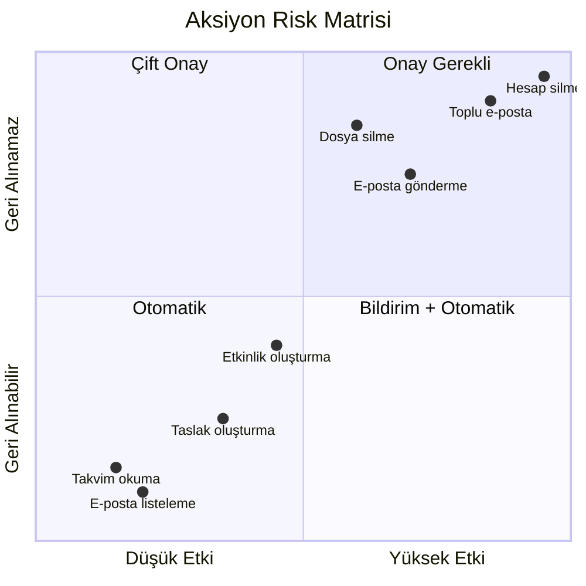
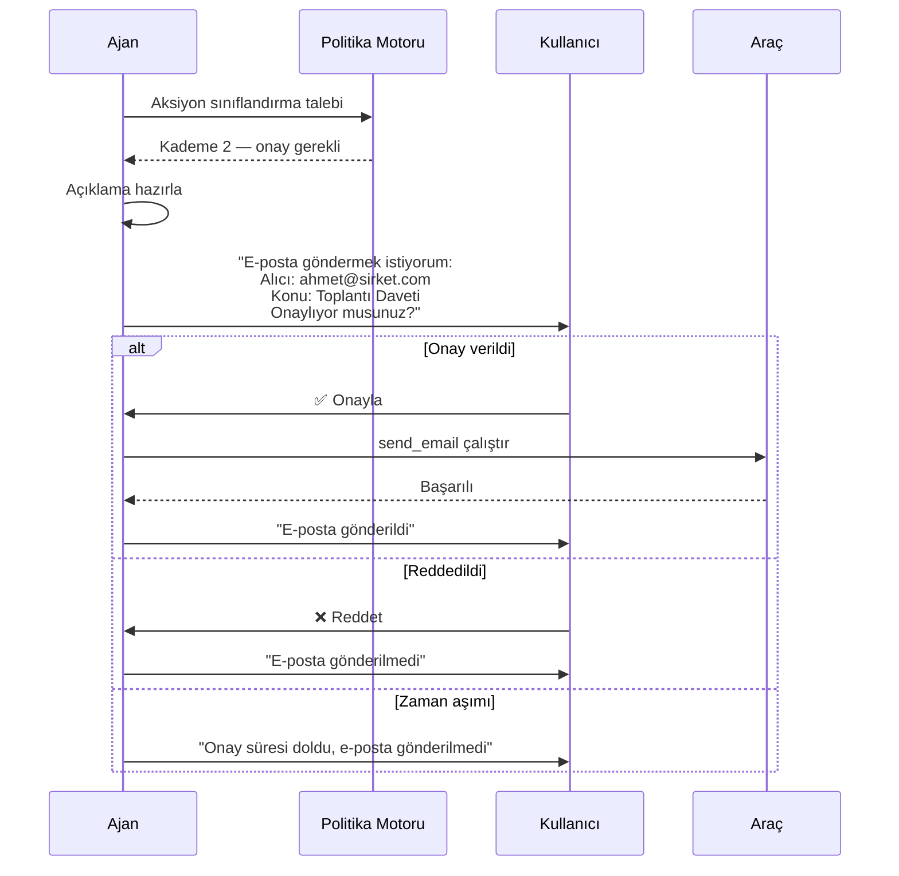
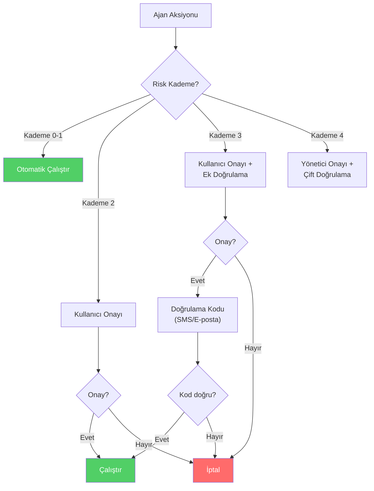

# İnsan Onayı ve Yönetişim (Human-in-the-Loop Governance)

## Genel Bakış

Ajan sistemlerinin en kritik güvenlik kontrollerinden biri, belirli aksiyonların **insan onayı olmadan** gerçekleştirilmemesini sağlamaktır. Her aksiyonu insana onaylatmak kullanılabilirliği yok eder; hiçbir aksiyonu onaylatmamak ise güvenliği yok eder. Doğru yaklaşım, **risk bazlı kademelendirme** ile hangi aksiyonların otomatik, hangilerinin onaylı olacağını belirlemektir.

Bu doküman, risk kademelendirmesini, geri alınabilir ve geri alınamaz aksiyon ayrımını, onay akışlarını, aşamalı doğrulamayı ve "açıkla-sonra-yap" kalıplarını kapsar.

---

## Risk Kademelendirme (Risk Tiering)

Tüm ajan aksiyonları eşit risk taşımaz. Risk kademelendirme, aksiyonları **etki** ve **geri alınabilirlik** boyutlarında sınıflandırır:



### Kademe Tanımları

| Kademe | Etki | Geri Alınabilirlik | Akış | Örnekler |
|---|---|---|---|---|
| **Kademe 0** | Düşük | N/A (okuma) | Otomatik | Takvim okuma, arama |
| **Kademe 1** | Düşük-Orta | Geri alınabilir | Bildirim + otomatik | Taslak oluşturma, etiketleme |
| **Kademe 2** | Orta-Yüksek | Kısmen geri alınabilir | Onay gerekli | E-posta gönderme, etkinlik oluşturma |
| **Kademe 3** | Yüksek | Geri alınamaz | Çift onay | Dosya silme, toplu işlem, ödeme |
| **Kademe 4** | Kritik | Geri alınamaz + sistem çapı | Yönetici onayı | Hesap silme, yetki değişikliği |

---

## Geri Alınabilir vs Geri Alınamaz Aksiyonlar

Bu ayrım, onay akışlarının tasarımında temel belirleyicidir:

```python
from dataclasses import dataclass
from enum import Enum
from typing import Optional


class Reversibility(str, Enum):
    FULLY_REVERSIBLE = "fully_reversible"       # Kolayca geri alınabilir
    PARTIALLY_REVERSIBLE = "partially_reversible"  # Kısmen geri alınabilir
    IRREVERSIBLE = "irreversible"               # Geri alınamaz


class RiskTier(int, Enum):
    TIER_0 = 0  # Otomatik
    TIER_1 = 1  # Bildirim
    TIER_2 = 2  # Onay
    TIER_3 = 3  # Çift onay
    TIER_4 = 4  # Yönetici onayı


@dataclass
class ActionClassification:
    action_name: str
    risk_tier: RiskTier
    reversibility: Reversibility
    requires_human_approval: bool
    approval_timeout_minutes: int = 15
    explanation_required: bool = False
    max_auto_executions_per_hour: Optional[int] = None


ACTION_CLASSIFICATIONS = {
    "read_calendar": ActionClassification(
        action_name="read_calendar",
        risk_tier=RiskTier.TIER_0,
        reversibility=Reversibility.FULLY_REVERSIBLE,
        requires_human_approval=False,
        max_auto_executions_per_hour=100,
    ),
    "draft_email": ActionClassification(
        action_name="draft_email",
        risk_tier=RiskTier.TIER_1,
        reversibility=Reversibility.FULLY_REVERSIBLE,
        requires_human_approval=False,
        max_auto_executions_per_hour=20,
    ),
    "send_email": ActionClassification(
        action_name="send_email",
        risk_tier=RiskTier.TIER_2,
        reversibility=Reversibility.IRREVERSIBLE,
        requires_human_approval=True,
        explanation_required=True,
        approval_timeout_minutes=15,
    ),
    "delete_file": ActionClassification(
        action_name="delete_file",
        risk_tier=RiskTier.TIER_3,
        reversibility=Reversibility.IRREVERSIBLE,
        requires_human_approval=True,
        explanation_required=True,
        approval_timeout_minutes=5,
    ),
    "bulk_send_email": ActionClassification(
        action_name="bulk_send_email",
        risk_tier=RiskTier.TIER_3,
        reversibility=Reversibility.IRREVERSIBLE,
        requires_human_approval=True,
        explanation_required=True,
        approval_timeout_minutes=10,
    ),
    "delete_account": ActionClassification(
        action_name="delete_account",
        risk_tier=RiskTier.TIER_4,
        reversibility=Reversibility.IRREVERSIBLE,
        requires_human_approval=True,
        explanation_required=True,
        approval_timeout_minutes=5,
    ),
}
```

---

## Onay Akışları (Approval Flows)

### Temel Onay Akışı



### Dinamik Onay Politikası

Onay politikaları statik değil, bağlama göre **dinamik** olmalıdır:

```python
from datetime import datetime


@dataclass
class ApprovalContext:
    """Onay kararını etkileyen bağlam bilgileri."""
    action_name: str
    user_id: str
    target: str
    data_sensitivity: str
    time_of_day: datetime
    recent_action_count: int
    is_first_time_action: bool
    is_known_recipient: bool


class DynamicApprovalPolicy:
    """Bağlama göre onay gereksinimini belirleyen politika motoru."""

    def evaluate(self, context: ApprovalContext) -> dict:
        classification = ACTION_CLASSIFICATIONS.get(context.action_name)
        if not classification:
            return {
                "approval_required": True,
                "reason": "Bilinmeyen aksiyon — varsayılan olarak onay gerekli",
                "tier": RiskTier.TIER_3.value,
            }

        tier = classification.risk_tier

        # Bağlama göre kademe yükseltme
        if context.is_first_time_action:
            tier = RiskTier(min(tier.value + 1, 4))

        if context.data_sensitivity in ["confidential", "restricted"]:
            tier = RiskTier(min(tier.value + 1, 4))

        if not context.is_known_recipient and context.action_name in [
            "send_email", "bulk_send_email"
        ]:
            tier = RiskTier(min(tier.value + 1, 4))

        if context.recent_action_count > 10:
            tier = RiskTier(min(tier.value + 1, 4))

        # Mesai dışı saatlerde ekstra dikkat
        hour = context.time_of_day.hour
        if hour < 7 or hour > 20:
            tier = RiskTier(min(tier.value + 1, 4))

        return {
            "approval_required": tier.value >= RiskTier.TIER_2.value,
            "tier": tier.value,
            "explanation_required": tier.value >= RiskTier.TIER_2.value,
            "timeout_minutes": max(5, 15 - (tier.value * 2)),
        }
```

---

## Açıkla-Sonra-Yap (Explain-Before-Act)

Yüksek etkili aksiyonlarda ajan, aksiyonu gerçekleştirmeden önce **ne yapacağını ve neden yapacağını** açıklamalıdır:

### Açıklama Şablonu

```python
@dataclass
class ActionExplanation:
    """Ajan aksiyonunun kullanıcıya açıklanması."""
    action: str
    target: str
    reason: str
    impact: str
    reversibility: str
    alternatives: list[str]

    def format_for_user(self) -> str:
        return (
            f"📋 Planlanan Aksiyon: {self.action}\n"
            f"🎯 Hedef: {self.target}\n"
            f"💡 Neden: {self.reason}\n"
            f"⚡ Etki: {self.impact}\n"
            f"🔄 Geri Alınabilirlik: {self.reversibility}\n"
            f"🔀 Alternatifler: {', '.join(self.alternatives)}\n"
            f"\nBu aksiyonu onaylıyor musunuz? [Evet / Hayır]"
        )


# Örnek kullanım
explanation = ActionExplanation(
    action="E-posta gönder",
    target="ahmet@sirket.com",
    reason="Kullanıcı yarınki toplantı için davet gönderilmesini istedi",
    impact="Alıcı bir toplantı daveti e-postası alacak",
    reversibility="Geri alınamaz — gönderilen e-posta geri çekilemez",
    alternatives=[
        "Taslak olarak kaydet (gönderme)",
        "Farklı bir alıcı belirle",
        "Aksiyonu iptal et",
    ],
)
```

---

## Aşamalı Doğrulama (Step-Up Verification)

Bazı aksiyonlar, standart onayın ötesinde **ek doğrulama** gerektirebilir:



---

## Yönetişim Çerçevesi

### Politika Hiyerarşisi

```
Organizasyon Politikası (en yüksek)
    ↓
Departman Politikası
    ↓
Uygulama Politikası
    ↓
Kullanıcı Tercihleri (en düşük)
```

**Kural:** Üst seviye politikalar alt seviyeler tarafından gevşetilemez. Bir organizasyon politikası "tüm e-posta göndermeleri onay gerektirir" diyorsa, kullanıcı bunu devre dışı bırakamaz.

### Yönetişim İlkeleri

| İlke | Açıklama |
|---|---|
| **Varsayılan kısıtlı** | Açıkça izin verilmeyen her aksiyon reddedilmeli |
| **Risk bazlı** | Onay gereksinimleri risk seviyesine göre belirlenmeli |
| **Şeffaf** | Ajan neden beklediğini veya neden onay istediğini açıklamalı |
| **Zaman sınırlı** | Onay talepleri belirli sürede yanıtlanmazsa otomatik reddedilmeli |
| **Denetlenebilir** | Tüm onay kararları loglanmalı |
| **Tutarlı** | Aynı risk seviyesindeki aksiyonlar aynı onay sürecinden geçmeli |

---

## İlgili Demo

→ [Onay Akışı Demo](../examples/approval_flow_demo.py)

## Sonraki Adımlar

- [OWASP Haritalama](owasp-mapping.md) — Risk haritalama
- [Dağıtım Güvenliği](deployment-security.md) — Altyapı güvenliği
