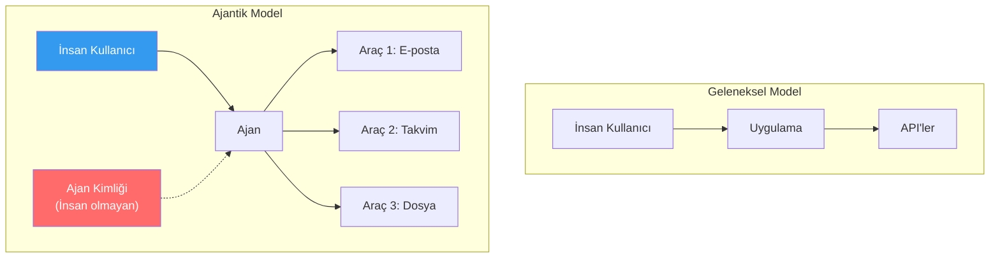
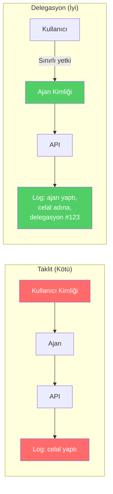
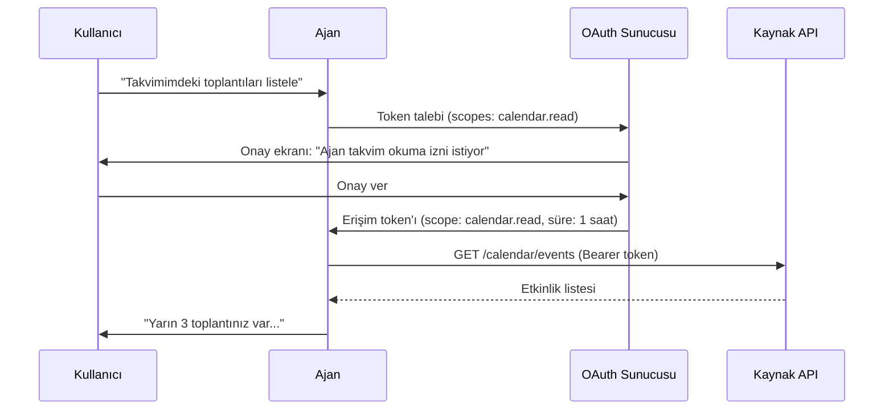
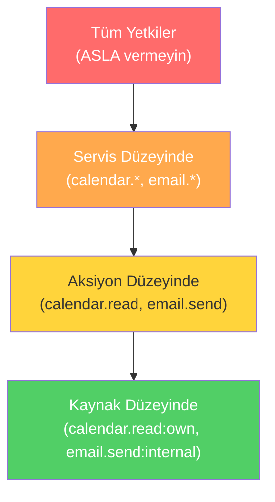
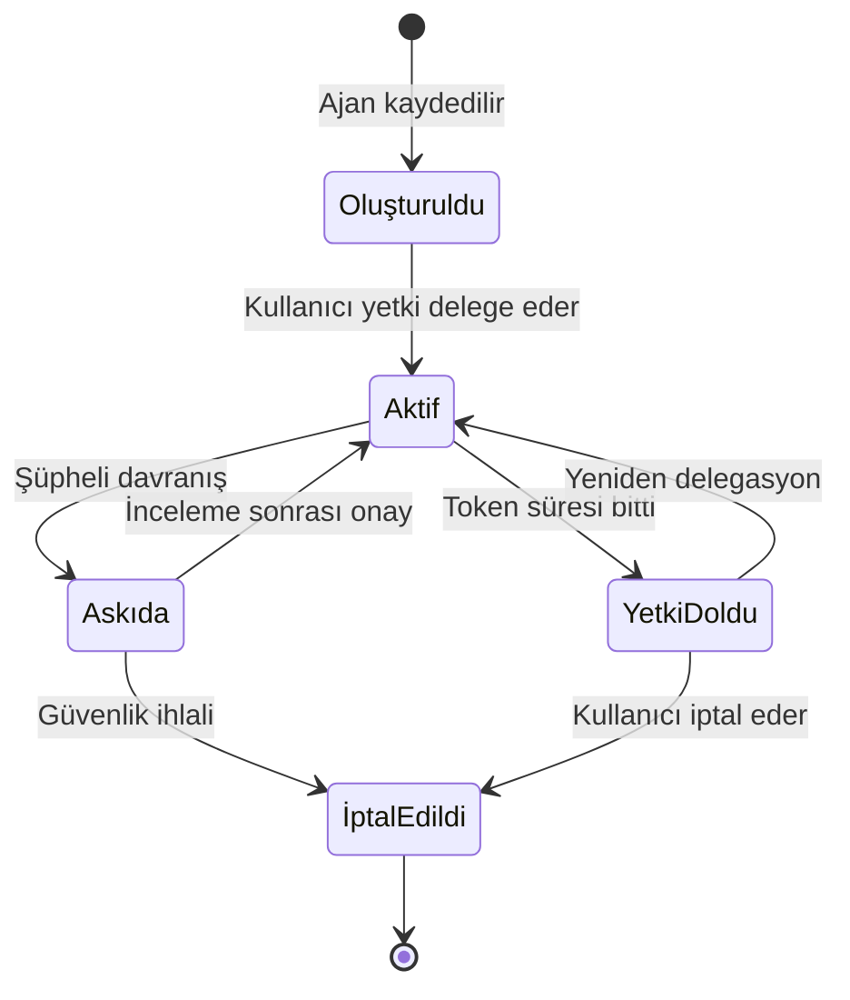

# Kimlik, Delegasyon ve En Az Yetki Erişimi

## Genel Bakış

Ajantik sistemlerde kimlik yönetimi, geleneksel uygulamalardan çok daha karmaşıktır. Bir ajan, **kullanıcı adına** hareket eder — ama kimin yetkilerini kullanır? Kimin kimliğiyle çalışır? Kullanıcının tüm yetkilerine mi yoksa sınırlı bir alt kümeye mi sahiptir?

Bu doküman, ajan kimlik modellerini, delegasyon mekanizmalarını, OAuth tabanlı yetkilendirmeyi ve en az yetki ilkesinin pratikte nasıl uygulanacağını kapsar.

---

## İnsan Olmayan Kimlikler (Non-Human Identities)

Geleneksel sistemlerde her kimlik bir insanı temsil eder. Ajan sistemlerinde ise **insan olmayan kimlikler** ortaya çıkar:



### Kimlik Modelleri

| Model | Açıklama | Risk | Kullanım Alanı |
|---|---|---|---|
| **Kullanıcı kimliği ile çalışma** | Ajan, kullanıcının token'ını kullanır | Aşırı yetki, takip zorluğu | Asla önerilmez |
| **Paylaşılan servis hesabı** | Tüm ajanlar tek bir kimlik kullanır | Ayrım yapılamaz, denetlenemez | Asla önerilmez |
| **Ayrı ajan kimliği** | Her ajan kendi kimliğine sahip | Yönetim yükü | Önerilen yaklaşım |
| **Delege edilmiş token** | Kullanıcı, sınırlı yetki delege eder | Karmaşıklık | En iyi yaklaşım |

---

## Taklit (Impersonation) vs Delegasyon

Bu iki kavram sıkça karıştırılır ama güvenlik açısından çok farklıdır:

### Taklit (Impersonation) — Tehlikeli

Ajan, kullanıcının tam kimliğini kullanarak hareket eder:

```
Kullanıcı: celal@sirket.com
Ajan çalıştığında: celal@sirket.com olarak API çağrıları yapar
Sonuç: Audit loglarında "celal yapıtı" görünür
       Ama aslında ajan yaptı — ayrım yapılamaz
```

**Riskler:**
- Ajan aksiyonları kullanıcı aksiyonlarından ayırt edilemez
- Denetim ve soruşturma imkansızlaşır
- Kullanıcının tüm yetkilerine erişim

### Delegasyon (Delegation) — Güvenli

Kullanıcı, ajana **sınırlı ve izlenebilir** bir yetki verir:

```
Kullanıcı: celal@sirket.com
Ajan kimliği: agent-calendar-assistant@sirket.com
Delege edilen yetkiler: takvim.oku, takvim.olustur
Süre: 1 saat
Sonuç: Audit loglarında "agent-calendar-assistant, 
       celal adına, delegasyon ile yaptı" görünür
```



---

## OAuth Tabanlı Delegasyon

OAuth 2.0, ajan delegasyonu için en uygun standarttır çünkü **kapsamlı** (scoped), **süreli** (time-limited) ve **geri alınabilir** (revocable) yetki vermeyi destekler.

### Delegasyon Akışı



### Python Uygulaması

```python
import uuid
from datetime import datetime, timedelta
from dataclasses import dataclass, field
from typing import Optional


@dataclass
class DelegatedToken:
    """Kullanıcının ajana delege ettiği sınırlı yetki token'ı."""

    token_id: str
    agent_id: str
    user_id: str
    scopes: list[str]
    issued_at: datetime
    expires_at: datetime
    revoked: bool = False
    max_uses: Optional[int] = None
    use_count: int = 0

    def is_valid(self) -> bool:
        if self.revoked:
            return False
        if datetime.utcnow() > self.expires_at:
            return False
        if self.max_uses and self.use_count >= self.max_uses:
            return False
        return True

    def has_scope(self, required_scope: str) -> bool:
        return required_scope in self.scopes

    def use(self):
        self.use_count += 1


class DelegationManager:
    """Ajan delegasyon token'larını yöneten servis."""

    VALID_SCOPES = {
        "calendar.read",
        "calendar.write",
        "email.read",
        "email.draft",
        "email.send",
        "contacts.read",
        "files.read",
    }

    def __init__(self, default_ttl_minutes: int = 60):
        self.tokens: dict[str, DelegatedToken] = {}
        self.default_ttl = default_ttl_minutes

    def create_delegation(
        self,
        agent_id: str,
        user_id: str,
        requested_scopes: list[str],
        ttl_minutes: Optional[int] = None,
        max_uses: Optional[int] = None,
    ) -> DelegatedToken:
        invalid_scopes = set(requested_scopes) - self.VALID_SCOPES
        if invalid_scopes:
            raise ValueError(f"Geçersiz scope'lar: {invalid_scopes}")

        ttl = ttl_minutes or self.default_ttl
        now = datetime.utcnow()

        token = DelegatedToken(
            token_id=str(uuid.uuid4()),
            agent_id=agent_id,
            user_id=user_id,
            scopes=requested_scopes,
            issued_at=now,
            expires_at=now + timedelta(minutes=ttl),
            max_uses=max_uses,
        )

        self.tokens[token.token_id] = token
        return token

    def validate_and_authorize(
        self,
        token_id: str,
        agent_id: str,
        required_scope: str,
    ) -> dict:
        token = self.tokens.get(token_id)
        if not token:
            return {"authorized": False, "reason": "Token bulunamadı"}

        if token.agent_id != agent_id:
            return {"authorized": False, "reason": "Token bu ajana ait değil"}

        if not token.is_valid():
            reason = "Token geçersiz: "
            if token.revoked:
                reason += "geri alındı"
            elif datetime.utcnow() > token.expires_at:
                reason += "süresi doldu"
            elif token.max_uses and token.use_count >= token.max_uses:
                reason += "kullanım limiti aşıldı"
            return {"authorized": False, "reason": reason}

        if not token.has_scope(required_scope):
            return {
                "authorized": False,
                "reason": f"Yetki kapsamı yetersiz. Gereken: {required_scope}, "
                          f"mevcut: {token.scopes}",
            }

        token.use()
        return {
            "authorized": True,
            "user_id": token.user_id,
            "agent_id": token.agent_id,
            "scope": required_scope,
            "remaining_uses": (
                token.max_uses - token.use_count if token.max_uses else None
            ),
        }

    def revoke(self, token_id: str) -> bool:
        token = self.tokens.get(token_id)
        if token:
            token.revoked = True
            return True
        return False

    def revoke_all_for_agent(self, agent_id: str) -> int:
        count = 0
        for token in self.tokens.values():
            if token.agent_id == agent_id and not token.revoked:
                token.revoked = True
                count += 1
        return count
```

---

## En Az Yetki İlkesi (Least Privilege)

Her ajan, görevini yerine getirmek için gereken **en dar yetki kapsamıyla** çalışmalıdır.

### Kapsam Hiyerarşisi



### En Az Yetki Matrisi

| Ajan Görevi | Gereken Yetkiler | Gereksiz Yetkiler |
|---|---|---|
| Takvim özeti | `calendar.read` | `calendar.write`, `email.*` |
| E-posta taslağı | `email.read`, `email.draft` | `email.send`, `contacts.write` |
| Toplantı daveti | `calendar.write`, `email.send` | `files.*`, `contacts.write` |
| Kişi arama | `contacts.read` | `contacts.write`, `email.*` |

### Uygulama İlkeleri

1. **Görev başına yetki**: Her görev için gereken minimum yetkiyi belirleyin
2. **Zaman sınırı**: Token'lar kısa ömürlü olmalı (dakikalar-saatler, günler değil)
3. **Kullanım sınırı**: Mümkünse token başına kullanım sayısını sınırlayın
4. **Otomatik iptal**: Görev tamamlandığında veya oturum sonlandığında token'ları iptal edin
5. **Düzenli denetim**: Verilen yetkileri periyodik olarak gözden geçirin

---

## Ajan Kimlik Yaşam Döngüsü



---

## Tasarım Tavsiyeleri

| Tavsiye | Açıklama |
|---|---|
| **Her ajana ayrı kimlik** | Paylaşılan kimlikler denetimi imkansız kılar |
| **Delegasyon, taklit değil** | Kullanıcı yetkilerini doğrudan kullanmayın |
| **Kısa ömürlü token'lar** | Token süresi dakika/saat olmalı |
| **Scope granülaritesi** | Geniş scope yerine dar, spesifik scope'lar |
| **Geri alma mekanizması** | Token'lar anında geri alınabilmeli |
| **Denetim izi** | Her delegasyon ve kullanım loglanmalı |

---

## İlgili Demo

→ [Delege Erişim Demo](../examples/delegated_access_demo.py)

## Sonraki Adımlar

- [Bellek ve Bağlam Güvenliği](memory-poisoning.md) — Bellek zehirlenmesi
- [Denetim ve Hesap Verebilirlik](audit-and-accountability.md) — Loglama ve iz sürme
