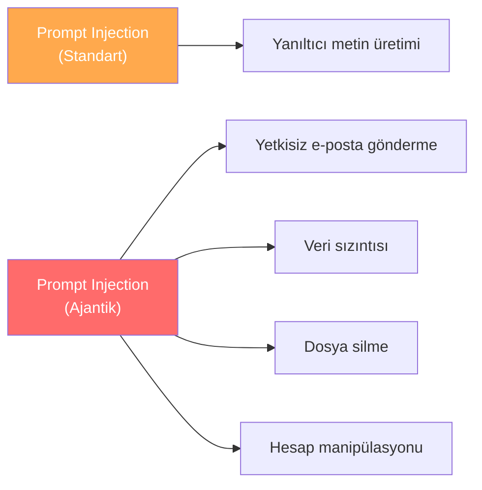
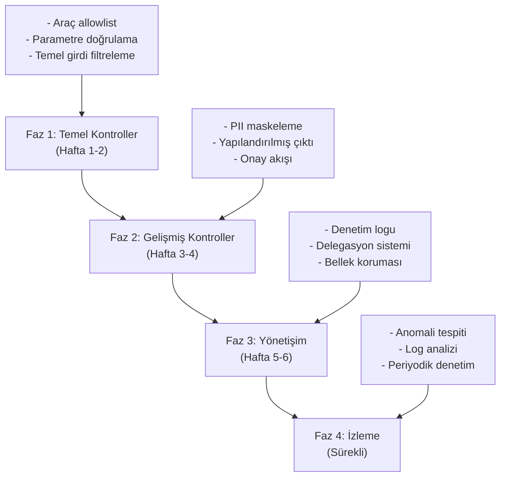

# OWASP Haritalama ve Güvenlik Kontrol Kataloğu

## Genel Bakış

Bu doküman, ajantik yapay zeka sistemlerinin güvenlik risklerini **OWASP Top 10 for LLM Applications** ile eşleştirir ve her risk için ajan spesifik kontrol önerileri sunar. OWASP LLM Top 10, büyük dil modeli uygulamalarına yönelik en kritik güvenlik risklerini tanımlar — bu repo ise bu risklerin **araç kullanan, aksiyon alan ajanlarda** nasıl farklılaştığını ve nasıl azaltılacağını gösterir.

---

## OWASP LLM Top 10 ve Ajan Eşleştirmesi

| OWASP ID | Risk | Ajantik Bağlamda Etki | Kontrol Dokümanı |
|---|---|---|---|
| **LLM01** | Prompt Injection | Doğrudan/dolaylı talimat enjeksiyonu ile araç çağrılarının manipülasyonu | [Prompt Injection](prompt-injection.md) |
| **LLM02** | Insecure Output Handling | Ajan çıktısının doğrulanmadan araçlara aktarılması | [Araç Güvenliği](tool-security.md) |
| **LLM03** | Training Data Poisoning | Bellek ve bağlam zehirlenmesi ile ajan davranışının kalıcı değiştirilmesi | [Bellek Güvenliği](memory-poisoning.md) |
| **LLM04** | Model Denial of Service | Ajanın sonsuz döngüye sokulması, kaynak tükenmesi | [Araç Güvenliği](tool-security.md) |
| **LLM05** | Supply Chain Vulnerabilities | Güvenilmeyen araçlar, eklentiler, model tedarik zinciri | [Dağıtım Güvenliği](deployment-security.md) |
| **LLM06** | Sensitive Information Disclosure | Ajan üzerinden hassas veri sızıntısı | [Veri Sızıntısı](data-exfiltration.md) |
| **LLM07** | Insecure Plugin Design | Araç parametrelerinin doğrulanmaması, güvensiz araç tasarımı | [Araç Güvenliği](tool-security.md) |
| **LLM08** | Excessive Agency | Ajana gereğinden fazla araç, yetki veya otonomi verilmesi | [Araç Güvenliği](tool-security.md) |
| **LLM09** | Overreliance | Ajan kararlarına aşırı güvenme, doğrulama eksikliği | [HITL Yönetişim](hitl-governance.md) |
| **LLM10** | Model Theft | Model veya sistem prompt'unun çalınması | [Prompt Injection](prompt-injection.md) |

---

## Detaylı Risk Analizi

### LLM01: Prompt Injection — Ajantik Bağlam

**Standart risk:** Kullanıcı, LLM'ye talimat enjekte eder.
**Ajantik fark:** Enjekte edilen talimat, **gerçek dünya aksiyonlarına** dönüşebilir.



**Kontroller:**
- Girdi filtreleme ve talimat/veri ayrımı
- Yapılandırılmış çıktı doğrulama
- Dış içerik etiketleme
- Araç çağırma öncesi politika kontrolü

### LLM07: Insecure Plugin Design — Araç Güvenliği

**Standart risk:** Plugin parametreleri doğrulanmaz.
**Ajantik fark:** Ajan, doğrulanmamış parametrelerle **gerçek sistemleri** etkiler.

| Güvensiz Tasarım | Güvenli Tasarım |
|---|---|
| Araç her parametreyi kabul eder | Pydantic şemasıyla parametre doğrulama |
| Serbest metin hedef adresi | Allowlist'teki adresler |
| Sınırsız dosya erişimi | Dizin bazlı kısıtlama |
| Rate limit yok | Dakika/saat bazında limit |

### LLM08: Excessive Agency — Aşırı Yetkilendirme

**Standart risk:** LLM çok fazla şey yapabilir.
**Ajantik fark:** Ajan, aşırı yetkiyle **geri alınamaz aksiyonlar** gerçekleştirir.

**Üç boyutu:**

```
1. Aşırı İşlevsellik: 50 araç yerine 5 araç ver
2. Aşırı İzinler: admin yerine scoped token ver
3. Aşırı Otonomi: onay mekanizması ekle
```

---

## Ajan Spesifik Risk Kategorileri

OWASP LLM Top 10'un ötesinde, ajantik sistemlere özgü ek risk kategorileri:

| Kategori | Açıklama | OWASP Eşleşmesi |
|---|---|---|
| **Confused Deputy** | Ajan, kendi yetkilerini saldırganın talimatları için kullanır | LLM01 + LLM08 |
| **Saldırı Zinciri** | Birden fazla araç üzerinden kademeli saldırı | LLM01 + LLM07 |
| **Bellek Kalıcılığı** | Zehirlenmiş bellek sonraki oturumlara yayılır | LLM03 |
| **Delegasyon Kötüye Kullanımı** | Ajan kimliğinin yetkisiz kullanımı | LLM08 |
| **Denetim Boşluğu** | Ajan kararlarının izlenememesi | LLM09 |
| **Otonom Yayılma** | Ajanın kontrol dışı zincirleme aksiyon alması | LLM08 |

---

## Risk Türüne Göre Kontrol Kataloğu

### Önleyici Kontroller

| Kontrol | Hedef Risk | Açıklama |
|---|---|---|
| Girdi filtreleme | LLM01 | Bilinen injection kalıplarını tespit et |
| Talimat/veri ayrımı | LLM01 | Delimiter ve etiketleme kullan |
| Yapılandırılmış çıktı | LLM02 | Pydantic şemasıyla çıktı doğrula |
| Araç allowlist | LLM08 | Sadece gereken araçları ver |
| Parametre doğrulama | LLM07 | Her parametreyi tip/değer kontrolünden geçir |
| Scoped delegation | LLM08 | Token'ları en dar kapsamla ver |
| Egress politikası | LLM06 | Giden veri kanallarını kontrol et |
| PII maskeleme | LLM06 | Hassas verileri otomatik maskele |
| Bellek yazma kontrolü | LLM03 | Dış kaynaklı talimatları bellekten engelle |

### Tespit Edici Kontroller

| Kontrol | Hedef Risk | Açıklama |
|---|---|---|
| Anomali tespiti | LLM01, LLM08 | Olağandışı araç çağırma kalıpları |
| Çıktı izleme | LLM06 | Hassas veri sızıntısı tespiti |
| Rate limit izleme | LLM04 | Aşırı araç çağırma tespiti |
| Bellek bütünlük denetimi | LLM03 | Periyodik bellek kontrolü |
| Log analizi | LLM09 | Karar izi analizi |

### Düzeltici Kontroller

| Kontrol | Hedef Risk | Açıklama |
|---|---|---|
| Token iptali | LLM08 | Şüpheli durumda delegasyonu iptal et |
| Bellek temizliği | LLM03 | Zehirlenmiş girişleri temizle |
| Oturum sonlandırma | LLM01 | Saldırı tespit edildiğinde oturumu kapat |
| Politika güncellemesi | Tümü | Yeni kalıplara karşı politikaları güncelle |
| Olay müdahale | Tümü | Soruşturma ve düzeltme süreci |

---

## Örnek Risk Azaltma Tablosu

| Senaryo | OWASP | Etki | Olasılık | Kontrol | Kalan Risk |
|---|---|---|---|---|---|
| E-posta içinden injection | LLM01 | Yüksek | Yüksek | Girdi filtre + talimat ayrımı + onay | Düşük |
| Ajanın tüm kişilere erişimi | LLM08 | Yüksek | Orta | Scoped permission | Düşük |
| PII e-posta ile sızdırma | LLM06 | Kritik | Orta | PII maskeleme + egress politikası | Düşük |
| Bellekte kalıcı talimat | LLM03 | Yüksek | Düşük | Bellek yazma kontrolü + denetim | Düşük |
| 100 araçlı ajan | LLM08 | Yüksek | Yüksek | Araç allowlist (5-10 araç) | Düşük |
| Onaysız dosya silme | LLM08 | Kritik | Orta | Risk kademelendirme + çift onay | Çok Düşük |

---

## Uygulama Yol Haritası

Kontrolleri uygulamak için önerilen öncelik sırası:



---

## Sonraki Adımlar

- [Dağıtım Güvenliği](deployment-security.md) — Altyapı güvenliği
- [Anti-Pattern'ler](anti-patterns.md) — Yaygın hatalar
