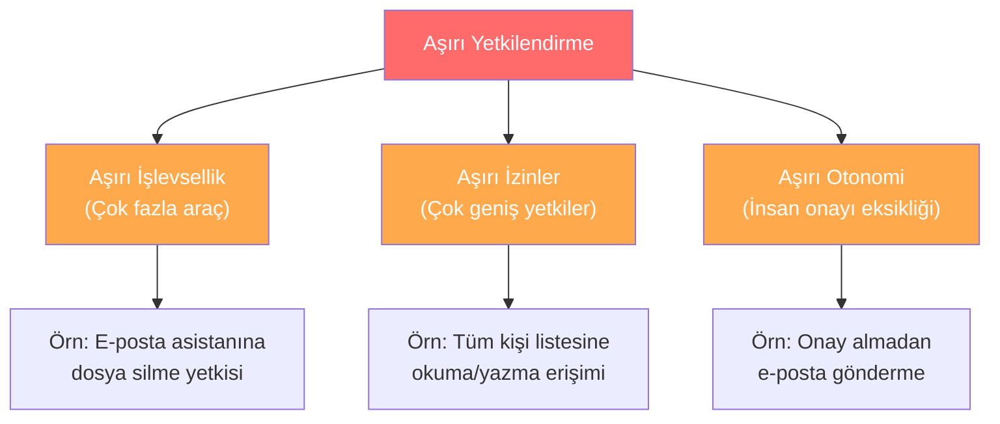
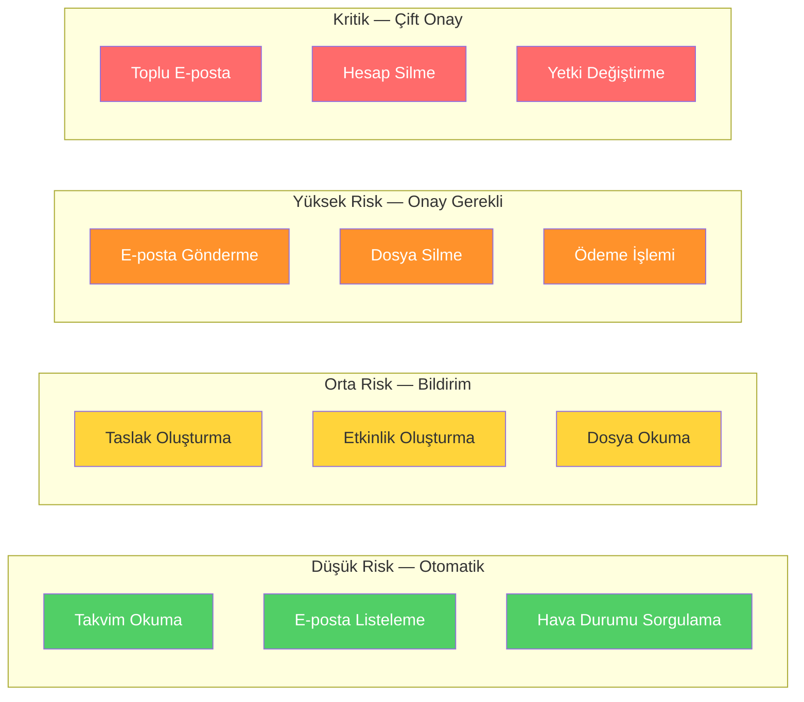
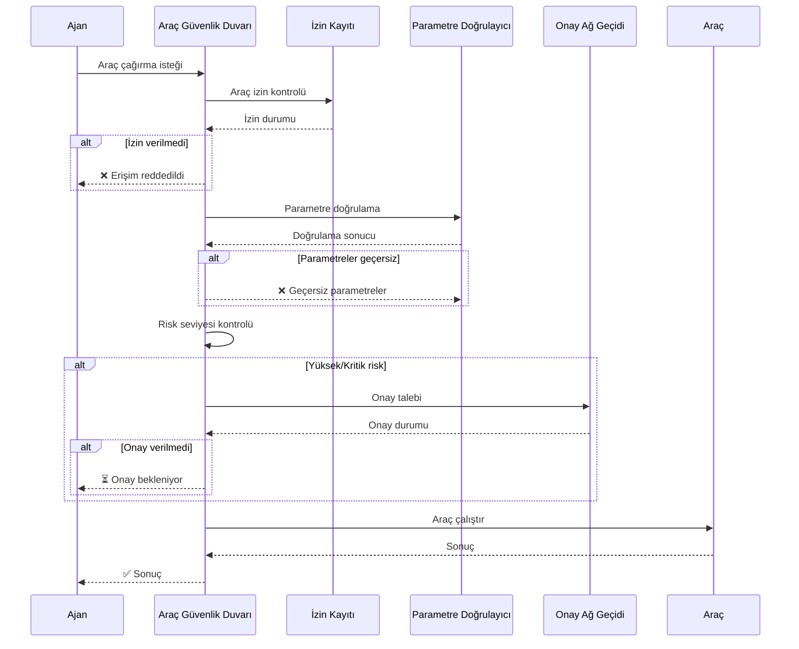

# Araç Güvenliği ve Aşırı Yetkilendirme

## Genel Bakış

Araçlar, ajantik sistemlerin gerçek dünyayla etkileşim kurmasını sağlar — e-posta göndermek, dosya okumak, API çağırmak, veritabanı sorgulamak. Ancak her araç aynı zamanda bir **saldırı yüzeyi** ve potansiyel bir **hasar mekanizmasıdır**.

Bu doküman, araç çağırma korumalarını, parametre doğrulamayı, kapsamlı izinleri, tehlikeli aksiyon sınıflandırmasını ve onay gerektiren araç akışlarını kapsar.

---

## Aşırı Yetkilendirme Problemi

OWASP LLM Top 10'da **LLM08: Excessive Agency** (Aşırı Yetkilendirme) olarak tanımlanan bu risk, ajanın gereğinden fazla araca, gereğinden geniş yetkilere veya gereğinden fazla otonomiye sahip olmasını ifade eder.

### Üç Boyutu



### Gerçek Hayat Örneği

Bir e-posta asistanı düşünün:

| Durum | İzinler | Risk Seviyesi |
|---|---|---|
| **Kötü tasarım** | Tüm araçlara erişim, tüm e-postalara okuma/yazma, dosya sistemi erişimi | Kritik |
| **Orta tasarım** | E-posta okuma/yazma, takvim okuma/yazma | Yüksek |
| **İyi tasarım** | E-posta okuma, taslak oluşturma (gönderme onay gerektirir), takvim okuma | Düşük |

---

## Araç Çağırma Korumaları (Tool Invocation Guardrails)

### 1. Araç İzin Listesi (Allowlist)

Ajana sadece görev için gerekli araçları verin:

```python
from dataclasses import dataclass, field
from enum import Enum
from typing import Callable, Optional


class ToolRiskLevel(str, Enum):
    LOW = "low"           # Okuma işlemleri
    MEDIUM = "medium"     # Yazma işlemleri (geri alınabilir)
    HIGH = "high"         # Gönderme/silme işlemleri (geri alınamaz)
    CRITICAL = "critical" # Toplu işlemler, yetki değişiklikleri


@dataclass
class ToolDefinition:
    name: str
    description: str
    risk_level: ToolRiskLevel
    requires_approval: bool
    allowed_roles: list[str]
    parameter_schema: dict
    rate_limit: Optional[int] = None  # dakika başına maks çağrı
    handler: Optional[Callable] = None


@dataclass
class ToolRegistry:
    """Kayıtlı araçları ve izinlerini yöneten merkezi kayıt."""

    tools: dict[str, ToolDefinition] = field(default_factory=dict)

    def register(self, tool: ToolDefinition):
        self.tools[tool.name] = tool

    def is_allowed(self, tool_name: str, user_role: str) -> bool:
        if tool_name not in self.tools:
            return False
        tool = self.tools[tool_name]
        return user_role in tool.allowed_roles

    def requires_approval(self, tool_name: str) -> bool:
        if tool_name not in self.tools:
            return True  # bilinmeyen araçlar her zaman onay gerektirir
        return self.tools[tool_name].requires_approval

    def get_risk_level(self, tool_name: str) -> ToolRiskLevel:
        if tool_name not in self.tools:
            return ToolRiskLevel.CRITICAL
        return self.tools[tool_name].risk_level


# Örnek kayıt
registry = ToolRegistry()

registry.register(ToolDefinition(
    name="read_calendar",
    description="Takvim etkinliklerini okur",
    risk_level=ToolRiskLevel.LOW,
    requires_approval=False,
    allowed_roles=["user", "assistant"],
    parameter_schema={"date_range": "string"},
))

registry.register(ToolDefinition(
    name="send_email",
    description="E-posta gönderir",
    risk_level=ToolRiskLevel.HIGH,
    requires_approval=True,
    allowed_roles=["assistant"],
    parameter_schema={
        "to": "string",
        "subject": "string",
        "body": "string",
    },
    rate_limit=10,
))

registry.register(ToolDefinition(
    name="delete_all_events",
    description="Tüm takvim etkinliklerini siler",
    risk_level=ToolRiskLevel.CRITICAL,
    requires_approval=True,
    allowed_roles=["admin"],
    parameter_schema={"confirm": "boolean"},
    rate_limit=1,
))
```

### 2. Parametre Doğrulama

Araç parametrelerini çağırma öncesinde doğrulayın:

```python
from pydantic import BaseModel, Field, field_validator
from typing import Optional


class SendEmailParams(BaseModel):
    to: str = Field(pattern=r"^[a-zA-Z0-9_.+-]+@[a-zA-Z0-9-]+\.[a-zA-Z0-9-.]+$")
    subject: str = Field(min_length=1, max_length=200)
    body: str = Field(min_length=1, max_length=10000)
    cc: Optional[list[str]] = Field(None, max_length=5)
    
    @field_validator("to")
    @classmethod
    def validate_recipient(cls, v):
        BLOCKED_DOMAINS = [
            "evil.com", "malicious.org", "exfil.io",
            "tempmail.com", "throwaway.email",
        ]
        domain = v.split("@")[1].lower()
        if domain in BLOCKED_DOMAINS:
            raise ValueError(f"Engellenen alan adı: {domain}")
        return v

    @field_validator("body")
    @classmethod
    def validate_body_content(cls, v):
        SENSITIVE_PATTERNS = [
            r"(?i)password\s*[:=]",
            r"(?i)api[_-]?key\s*[:=]",
            r"\b\d{4}[\s-]?\d{4}[\s-]?\d{4}[\s-]?\d{4}\b",  # kredi kartı
        ]
        import re
        for pattern in SENSITIVE_PATTERNS:
            if re.search(pattern, v):
                raise ValueError("E-posta gövdesinde hassas veri tespit edildi")
        return v


def validate_tool_params(tool_name: str, params: dict) -> dict:
    """Araç parametrelerini şemaya karşı doğrular."""
    VALIDATORS = {
        "send_email": SendEmailParams,
    }
    validator = VALIDATORS.get(tool_name)
    if validator:
        validated = validator(**params)
        return validated.model_dump()
    return params
```

---

## Tehlikeli Aksiyon Sınıflandırması

Araç aksiyonlarını risk seviyesine göre sınıflandırın:



### Risk Sınıflandırma Matrisi

| Risk Seviyesi | Geri Alınabilir mi? | Kapsam | Akış | Örnek |
|---|---|---|---|---|
| **Düşük** | N/A (okuma) | Tekil kaynak | Otomatik | Takvim okuma |
| **Orta** | Evet | Tekil kaynak | Bildirim + otomatik | Taslak oluşturma |
| **Yüksek** | Zor/Hayır | Tekil hedef | Onay gerekli | E-posta gönderme |
| **Kritik** | Hayır | Toplu/Sistem çapı | Çift onay | Toplu silme |

---

## Onay Gerektiren Araç Akışları

Yüksek ve kritik risk seviyesindeki araçlar için onay akışı:

```python
import uuid
from datetime import datetime, timedelta
from dataclasses import dataclass, field
from enum import Enum
from typing import Optional


class ApprovalStatus(str, Enum):
    PENDING = "pending"
    APPROVED = "approved"
    REJECTED = "rejected"
    EXPIRED = "expired"


@dataclass
class ApprovalRequest:
    request_id: str
    tool_name: str
    parameters: dict
    risk_level: ToolRiskLevel
    reason: str
    created_at: datetime
    expires_at: datetime
    status: ApprovalStatus = ApprovalStatus.PENDING
    approved_by: Optional[str] = None
    correlation_id: Optional[str] = None


class ApprovalGateway:
    """Yüksek riskli araç çağrıları için onay mekanizması."""

    def __init__(self, expiry_minutes: int = 15):
        self.pending_requests: dict[str, ApprovalRequest] = {}
        self.expiry_minutes = expiry_minutes

    def request_approval(
        self,
        tool_name: str,
        parameters: dict,
        risk_level: ToolRiskLevel,
        reason: str,
        correlation_id: str,
    ) -> ApprovalRequest:
        now = datetime.utcnow()
        request = ApprovalRequest(
            request_id=str(uuid.uuid4()),
            tool_name=tool_name,
            parameters=parameters,
            risk_level=risk_level,
            reason=reason,
            created_at=now,
            expires_at=now + timedelta(minutes=self.expiry_minutes),
            correlation_id=correlation_id,
        )
        self.pending_requests[request.request_id] = request
        return request

    def approve(self, request_id: str, approved_by: str) -> bool:
        request = self.pending_requests.get(request_id)
        if not request:
            return False
        if request.expires_at < datetime.utcnow():
            request.status = ApprovalStatus.EXPIRED
            return False
        request.status = ApprovalStatus.APPROVED
        request.approved_by = approved_by
        return True

    def reject(self, request_id: str) -> bool:
        request = self.pending_requests.get(request_id)
        if not request:
            return False
        request.status = ApprovalStatus.REJECTED
        return True

    def is_approved(self, request_id: str) -> bool:
        request = self.pending_requests.get(request_id)
        if not request:
            return False
        return request.status == ApprovalStatus.APPROVED
```

---

## Araç Güvenlik Duvarı (Tool Firewall)

Tüm araç çağrılarının geçtiği merkezi bir güvenlik katmanı:



### Güvenlik Duvarı Uygulaması

```python
@dataclass
class ToolFirewall:
    """Tüm araç çağrılarını kontrol eden merkezi güvenlik katmanı."""

    registry: ToolRegistry
    approval_gateway: ApprovalGateway
    call_counts: dict[str, int] = field(default_factory=dict)

    def execute(
        self,
        tool_name: str,
        params: dict,
        user_role: str,
        correlation_id: str,
    ) -> dict:
        # 1. Araç varlık kontrolü
        if tool_name not in self.registry.tools:
            return {"error": "Bilinmeyen araç", "tool": tool_name}

        tool = self.registry.tools[tool_name]

        # 2. İzin kontrolü
        if not self.registry.is_allowed(tool_name, user_role):
            return {
                "error": "Erişim reddedildi",
                "tool": tool_name,
                "role": user_role,
            }

        # 3. Rate limit kontrolü
        if tool.rate_limit:
            count = self.call_counts.get(tool_name, 0)
            if count >= tool.rate_limit:
                return {
                    "error": "Oran sınırı aşıldı",
                    "tool": tool_name,
                    "limit": tool.rate_limit,
                }

        # 4. Parametre doğrulama
        try:
            validated_params = validate_tool_params(tool_name, params)
        except ValueError as e:
            return {"error": f"Parametre doğrulama hatası: {e}"}

        # 5. Onay kontrolü
        if tool.requires_approval:
            request = self.approval_gateway.request_approval(
                tool_name=tool_name,
                parameters=validated_params,
                risk_level=tool.risk_level,
                reason=f"{tool_name} çağrısı onay bekliyor",
                correlation_id=correlation_id,
            )
            return {
                "status": "approval_required",
                "request_id": request.request_id,
                "tool": tool_name,
                "message": "Bu işlem kullanıcı onayı gerektiriyor",
            }

        # 6. Çalıştır
        self.call_counts[tool_name] = self.call_counts.get(tool_name, 0) + 1
        if tool.handler:
            return tool.handler(validated_params)
        return {"status": "executed", "tool": tool_name, "params": validated_params}
```

---

## Tasarım İlkeleri

### En Az Yetki İlkesi (Least Privilege)
- Ajana sadece mevcut görev için gereken araçları verin
- Her araç için gereken en dar yetki kapsamını tanımlayın
- Yetkileri görev tamamlandığında geri alın

### Varsayılan Reddetme (Default Deny)
- Tanımlanmamış araçlar otomatik olarak reddedilmeli
- Bilinmeyen parametreler görmezden gelinmemeli, hata döndürülmeli
- Onay durumu belirsizse, onay gerekli olarak işlem yapılmalı

### Derinlemesine Savunma
- İzin kontrolü + parametre doğrulama + onay akışı + loglama
- Her katman bağımsız çalışmalı
- Tek bir katmanın aşılması tüm sistemi tehlikeye atmamalı

---

## İlgili Demo

→ [Araç İzin Koruma Demo](../examples/tool_permission_guard_demo.py)
→ [Onay Akışı Demo](../examples/approval_flow_demo.py)

## Sonraki Adımlar

- [Veri Sızıntısı Önleme](data-exfiltration.md) — Giden veri kontrolü
- [Kimlik ve Delegasyon](identity-and-delegation.md) — Ajan kimlik yönetimi
